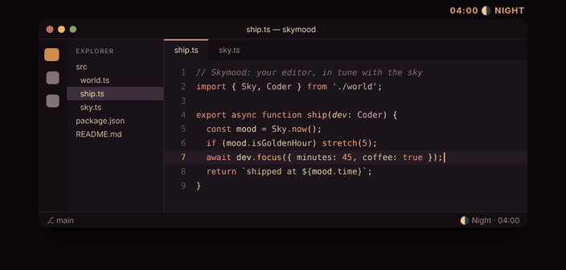
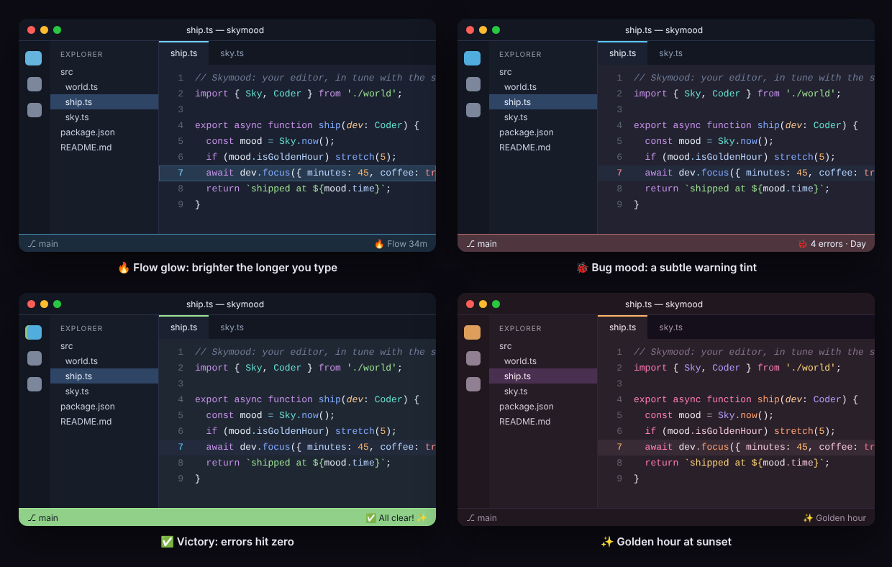

# Skymood

### The VS Code theme that lives on your schedule ☀️ 🌅 🌙

A theme that shifts with the real sky, from crisp daylight to warm, low-blue night. In dark and light.
It also notices you: it glows when you're in the flow, breathes a soft red when errors show up, and throws confetti when they hit zero.

---

## ✨ Why you'll love it

| | |
|---|---|
| 🌗 **One theme, every hour** | Four hand-tuned palettes (Night, Dawn, Day, Dusk) blend smoothly, minute by minute, with no jarring switch. |
| 🌓 **Dark, light or system** | Dark by default. Choose **Light** for the same four moods on paper, or **System default** to follow your OS. |
| ☀️ **Follows your real sun** | Enter your city's coordinates once. Skymood calculates sunrise and sunset for every day of the year, **offline**. |
| 😌 **Easy on the eyes at night** | Night warmth gently cuts blue light after dark. You choose how strong. |
| 👓 **Readable at every hour** | Every blend is contrast-checked: code text stays at or above WCAG AA, all day. |

## 🌦️ Atmosphere profiles (new in 2.0)

Layer a mood over the four solar phases, in both dark and light. Pick one from the status bar menu, **Skymood: Select Atmosphere Profile**, or `skymood.atmosphere`.

| Atmosphere | What it does |
|---|---|
| **Clear** (default) | The crisp solar palette. |
| **Overcast** | Monsoon and rainy days: about 28% less chroma, cool slate neutrals (235°) and softer contrast for long, grey sessions. |
| **Arctic** | Crisp ice tones (215° hue bias) with longer twilight transitions. |
| **Amber** | Deep warm comfort mode (55° hue bias) with strong blue-light attenuation at every hour. |

Colors are blended in a perceptual color space (OKLab/OKLCH), and a contrast clamp runs **last**, after the atmosphere, night warmth and every playful tint, so code text stays at or above WCAG AA (4.5:1, comments 3:1) in all four atmospheres, all day. `npm test` checks every minute of the day.

## 📍 City picker

**Skymood: Set Location for Sunrise & Sunset** opens a list of 350 major cities, or lets you type coordinates (`12.97, 77.59`). Pick one and Skymood sets your latitude, longitude and city, switches to solar mode and repaints right away. The list ships inside the extension. Nothing is looked up online.

## 🎮 Playful touches

- 🔥 **Flow glow.** Type steadily for 5, 15 or 30 minutes and the accents grow brighter, with a 🔥 badge at each milestone. The status bar counts your streak. Take a break and it calms down.
- 🐞 **Bug mood.** When new errors show up in your open files, the editor slowly fades to a soft red and back, twice, then keeps a subtle warning tint while errors remain. More errors, a slightly deeper red. Errors that only flicker while you type a line don't count, and it pulses at most once every 30 seconds. It's a nudge, never a distraction.
- 🎉 **Victory.** Fix the last error in your open files and confetti bursts over your editor, in the colors of the current hour, around a badge saying how many you fixed. The more you fixed, the bigger the party: 👍 for one or two, 🙌 for a handful, 🏆 and a double burst for ten or more.
- ✨ **Golden hour.** A warm golden shimmer around sunrise and sunset.
- 🌕 **Moon phase.** Tonight's moon in the status bar, and a silver moonlight accent on full-moon nights.

Every effect can be switched off on its own, or all at once with **Skymood: Toggle Playful Effects**. Confetti and the red pulse are skipped when `workbench.reduceMotion` is on.

## 🚀 Try it in 10 seconds

1. Install, then click **Turn on** in the welcome message. Want light mode, or to follow your OS? Click Skymood in the status bar and choose **Appearance**.
2. Run **Skymood: Preview a Full Day** (`Ctrl+Shift+P` / `Cmd+Shift+P`) and watch 24 hours go by in 7 seconds.
3. Optional: **Skymood: Set Location for Sunrise & Sunset** → `12.97, 77.59` (Bengaluru, for example).

## ⌨️ Commands

| Command | What it does |
|---|---|
| Skymood: Turn On Adaptive Theme | Activates Skymood, in the mode set by `skymood.appearance` |
| Skymood: Preview a Full Day | Animates the full 24-hour cycle |
| Skymood: Pin a Phase / Follow the Sun | Locks one palette, or returns to automatic |
| Skymood: Set Location for Sunrise & Sunset | Pick a city or enter coordinates; switches to real solar times |
| Skymood: Select Atmosphere Profile | Clear, Overcast, Arctic or Amber |
| Skymood: Copy Setup Card (Share Your Sky) | Copies a Markdown card of your phase, atmosphere, moon and flow streak; can save it as a 600×240 SVG |
| Skymood: Configure Settings Sync for Multi-Machine | Keeps Skymood's colors per machine, in one click |
| Skymood: Toggle Playful Effects | All playful effects on or off |
| Skymood: Celebrate! | Because you deserve it |
| Skymood: Remove Adaptive Overrides from Settings | Cleans up everything Skymood wrote |

Or just click the Skymood item in the status bar, which is also where you switch between dark and light.

## ⚙️ Settings

| Setting | Default | Description |
|---|---|---|
| `skymood.appearance` | `dark` | `dark`, `light` or `system` (follow your OS); switches right away |
| `skymood.mode` | `clock` | `clock` uses fixed times, `solar` uses your location |
| `skymood.sunrise` / `skymood.sunset` | `06:30` / `18:30` | Times used in clock mode |
| `skymood.latitude` / `skymood.longitude` | — | Your location for solar mode |
| `skymood.cityName` | — | Label for your location (set by the city picker) |
| `skymood.atmosphere` | `clear` | `clear`, `overcast`, `arctic` or `amber` |
| `skymood.nightWarmth` | `0.4` | Blue-light reduction at night (0–1) |
| `skymood.pinnedPhase` | `auto` | `auto`, `night`, `dawn`, `day` or `dusk` |
| `skymood.playful.enabled` | `true` | Master switch for playful effects |
| `skymood.playful.flowGlow` / `bugMood` / `errorPulse` / `celebrate` / `confetti` / `goldenHour` / `moonPhase` | `true` | Each effect on its own |
| `skymood.updateIntervalMinutes` | `5` | How often the colors refresh |
| `skymood.showStatusBar` | `true` | Show the status bar item |

## 🎨 Also included

Prefer a fixed look? These are included as regular themes:

| Dark | Light |
|---|---|
| Skymood Night | Skymood Night Light (warm cream, low blue) |
| Skymood Dawn | Skymood Dawn Light (rose on lavender-white) |
| Skymood Day | Skymood Daylight (crisp cool white) |
| Skymood Dusk | Skymood Dusk Light (soft peach) |

**Appearance: System default** switches between Skymood Adaptive and Skymood Adaptive Light with your OS. It turns on VS Code's `window.autoDetectColorScheme` for you, and choosing Dark or Light turns it off again. If you already had it on, Skymood starts in System default.

## 🔒 Privacy and how it works

Everything runs locally: no network calls and no telemetry, and your location stays on your machine. Skymood writes its colors into `workbench.colorCustomizations` and `editor.tokenColorCustomizations`, **scoped to `[Skymood Adaptive]` and `[Skymood Adaptive Light]` only**, so your other themes and your own tweaks are untouched. With several windows open, the one you're working in sets the colors.

**Settings Sync on several machines?** Those two settings sync like any other, so machines in different timezones would keep repainting each other. Run **Skymood: Configure Settings Sync for Multi-Machine** and Skymood adds both to `settingsSync.ignoredSettings` for you, keeping every entry you already had. If it notices another machine or window repeatedly rewriting its colors, it offers the same tip once. Note that this also stops syncing any color customizations of your own.

The setup card shares only what you copy or save, and the counts behind the one-time thank-you (celebrations and time in flow) never leave your machine. Skymood never records what you type.

## 💬 Community

Questions, ideas, or a screenshot of your setup at golden hour? Join the [Skymood Discord](https://discord.gg/2jrg7VyS3). Found a bug? [Open an issue](https://github.com/Nandha65/skymood-theme/issues).

## 🆚 Skymood Core and Skymood Studio

| | **Skymood Core** (free, MIT) | **Skymood Studio** ([$5/month sponsors](https://github.com/sponsors/Nandha65) or [$12 once on Gumroad](https://techrefiner.gumroad.com/l/skymood-studio)) |
|---|---|---|
| VS Code adaptive engine, dark and light | ✅ | ✅ |
| Real solar and lunar astronomy, offline | ✅ | ✅ |
| 4 atmospheres and city picker | ✅ | ✅ |
| Playful effects and setup card | ✅ | ✅ |
| 4K and 5K dynamic wallpapers, with a Windows and macOS background switcher | | ✅ |
| 7 terminal and shell ports: Windows Terminal, iTerm2, Ghostty, Warp, Alacritty, WezTerm, Starship | | ✅ |
| Custom accent generator: your brand color to a VS Code, terminal and wallpaper bundle | | ✅ |
| Private repo access, with every update | | ✅ |

## ❤️ Support

Skymood is free, MIT-licensed and built in the open. If it makes your late-night coding a little kinder on the eyes:

- [**Sponsor the project**](https://github.com/sponsors/Nandha65) to keep it maintained
- Leave a ⭐ on [GitHub](https://github.com/Nandha65/skymood-theme)
- Share your sky with **Skymood: Copy Setup Card**

More tools by Nandha Kumar: [PlanForge](https://planforge.web.app), a TypeScript engine for spatial layout editors and grid planners.

MIT License · Made by Nandha Kumar
