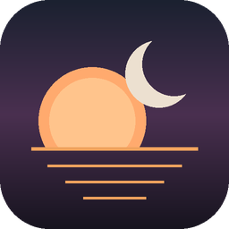
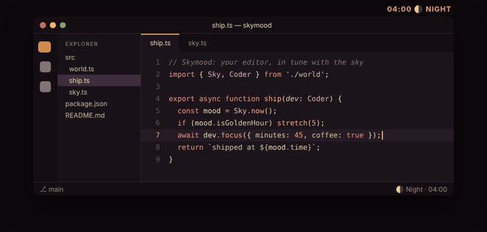
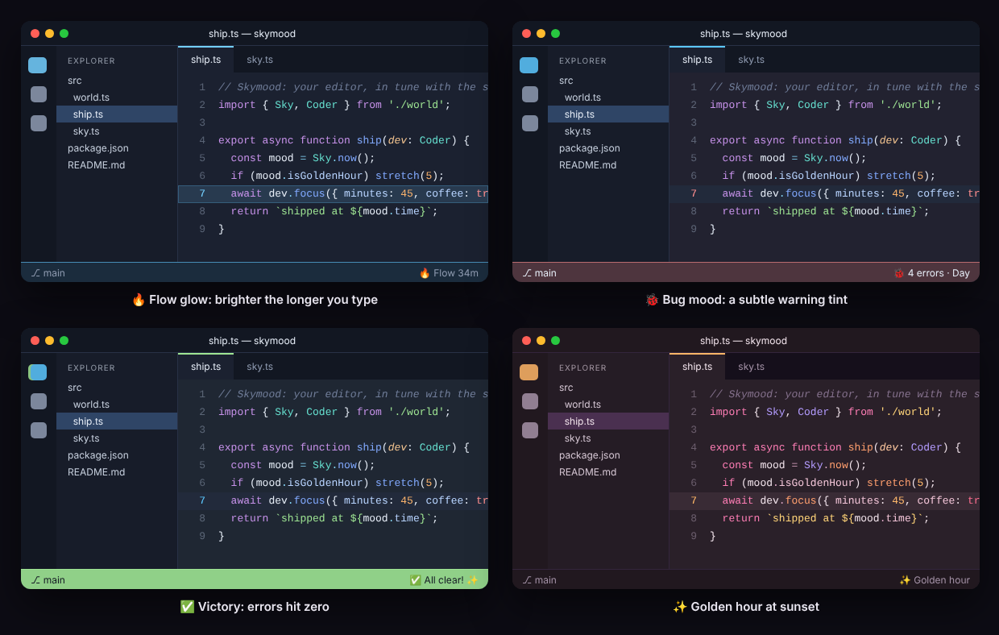

<div align="center">



# Skymood

### The VS Code theme that lives on your schedule ☀️ 🌅 🌙

Your editor shifts with the real sky, from crisp daylight to warm, low-blue night.
It also notices you: it glows when you're in the flow and celebrates when your errors hit zero.



</div>

---

## ✨ Why you'll love it

| | |
|---|---|
| 🌗 **One theme, every hour** | Four hand-tuned palettes (Night, Dawn, Day, Dusk) blend smoothly, minute by minute, with no jarring light/dark switch. |
| ☀️ **Follows your real sun** | Enter your city's coordinates once. Skymood calculates sunrise and sunset for every day of the year, **offline**. |
| 😌 **Easy on the eyes at night** | Night warmth gently cuts blue light after dark. You choose how strong. |
| 👓 **Readable at every hour** | Every blend is contrast-checked: code text stays at or above WCAG AA, all day. |

## 🎮 Playful touches



- 🔥 **Flow glow.** Type steadily for 5, 15 or 30 minutes and the accents grow brighter. The status bar counts your streak. Take a break and it calms down.
- 🐞 **Bug mood.** As errors pile up in your open files, the editor picks up a subtle warning tint. It's a nudge, never a distraction.
- ✅ **Victory.** Fix the last error in your open files and the status bar does a quick celebration.
- ✨ **Golden hour.** A warm golden shimmer around sunrise and sunset.
- 🌕 **Moon phase.** Tonight's moon in the status bar, and a silver moonlight accent on full-moon nights.

Every effect can be switched off on its own, or all at once with **Skymood: Toggle Playful Effects**.

## 🚀 Try it in 10 seconds

1. Install, then click **Turn on** in the welcome message.
2. Run **Skymood: Preview a Full Day** (`Ctrl+Shift+P` / `Cmd+Shift+P`) and watch 24 hours go by in 7 seconds.
3. Optional: **Skymood: Set Location for Sunrise & Sunset** → `12.97, 77.59` (Bengaluru, for example).

## ⌨️ Commands

| Command | What it does |
|---|---|
| Skymood: Turn On Adaptive Theme | Activates *Skymood Adaptive* |
| Skymood: Preview a Full Day | Animates the full 24-hour cycle |
| Skymood: Pin a Phase / Follow the Sun | Locks one palette, or returns to automatic |
| Skymood: Set Location for Sunrise & Sunset | Switches to real solar times |
| Skymood: Toggle Playful Effects | All playful effects on or off |
| Skymood: Celebrate! | Because you deserve it |
| Skymood: Remove Adaptive Overrides from Settings | Cleans up everything Skymood wrote |

Or just click the Skymood item in the status bar.

## ⚙️ Settings

| Setting | Default | Description |
|---|---|---|
| `skymood.mode` | `clock` | `clock` uses fixed times, `solar` uses your location |
| `skymood.sunrise` / `skymood.sunset` | `06:30` / `18:30` | Times used in clock mode |
| `skymood.latitude` / `skymood.longitude` | — | Your location for solar mode |
| `skymood.nightWarmth` | `0.4` | Blue-light reduction at night (0–1) |
| `skymood.pinnedPhase` | `auto` | `auto`, `night`, `dawn`, `day` or `dusk` |
| `skymood.playful.enabled` | `true` | Master switch for playful effects |
| `skymood.playful.flowGlow` / `bugMood` / `celebrate` / `goldenHour` / `moonPhase` | `true` | Each effect on its own |
| `skymood.updateIntervalMinutes` | `5` | How often the colors refresh |
| `skymood.showStatusBar` | `true` | Show the status bar item |

## 🎨 Also included

Prefer a fixed look? **Skymood Night**, **Dawn**, **Day** and **Dusk** are included as regular themes.

## 🔒 Privacy and how it works

Everything runs locally: no network calls and no telemetry, and your location stays on your machine. Skymood writes its colors into `workbench.colorCustomizations` and `editor.tokenColorCustomizations`, **scoped to `[Skymood Adaptive]` only**, so your other themes and your own tweaks are untouched. With several windows open, the one you're working in sets the colors.

**Settings Sync on several machines?** Those two settings sync like any other, so machines in different timezones would keep repainting each other. To keep Skymood's colors per machine, add this to your user settings. Note that it also stops syncing any color customizations of your own.

```json
"settingsSync.ignoredSettings": ["workbench.colorCustomizations", "editor.tokenColorCustomizations"]
```

## ❤️ Support

If Skymood makes your late-night coding a little kinder on the eyes, [sponsor the project](https://github.com/sponsors/Nandha65) or leave a ⭐ on [GitHub](https://github.com/Nandha65/skymood-theme).

<sub>MIT License · Made by Nandha Kumar</sub>
